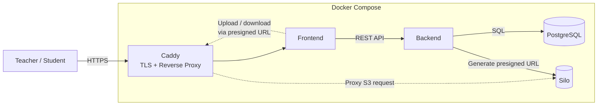

# Архитектура

## Требования

### Бизнес-требования
1. Доступность в браузере после деплоя
2. Хранение структурированных и неструктурированных данных
3. Низкие требования к серверу

### Требуемые компоненты
1. Фронтенд-сервер для web
2. Бэкенд-сервер с api
3. База данных для структурированных данных (учетные записи, занятия, домашки)
4. S3-хранилище для неструктурированных данных (файлы заданий и решений, записи занятий)
5. Proxy для SSL и https

## Сервисы
| Тип | Название / Технология | Почему именно это |
| --- | --------------------- | ----------------- |
| Proxy | Caddy | Быстро настроить одним файлом |
| S3 | Silo | drop-in замена популярного MinIO |
| SQL СУБД | Postgresql | Популярная и знакомая |
| Backend | Python | Удобно в разработке |
| Frontend | React | Единственная нормальная опция |

### Структура деплоя

